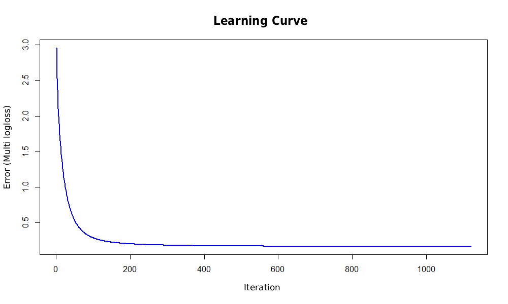

# LightGBM Multiclass Classification

## Overview

This project focuses on developing and evaluating a multiclass classification model using **LightGBM** in R.

The objective was to build a high-performing model capable of classifying observations into **26 different classes**. The project covers data preparation, model configuration, cross-validation, hyperparameter tuning, and model evaluation.

## Technologies & Libraries

- **R**
- **LightGBM** – gradient boosting framework
- **caret** – machine learning utilities
- **tidyverse** – data manipulation
- **data.table** – efficient data handling
- **MLmetrics** – classification metrics
- **pROC** – ROC curves and AUC calculation

## Dataset

- **6,238 observations**
- **617 input features**
- **26 target classes**

The dataset was provided as part of a university assignment and is not included in this repository.

## Methodology

### 1. Data Preparation

- Loaded and prepared the dataset.
- Removed an unnecessary index column.
- Split the data into training (80%) and test (20%) sets.
- Converted target labels into numerical values starting from 0, as required by LightGBM.

### 2. Model Configuration & Training

Implemented a multiclass classification model using LightGBM.

Selected hyperparameters:

| Parameter | Value |
|---|---:|
| Objective | multiclass |
| Learning rate | 0.03 |
| Number of leaves | 50 |
| Minimum data in leaf | 25 |
| Maximum depth | -1 |
| L1 regularization | 0.2 |
| L2 regularization | 2 |
| Feature fraction | 0.6 |
| Bagging fraction | 0.8 |

### 3. Cross-Validation & Hyperparameter Tuning

Used **5-fold cross-validation** on the training set to evaluate model performance and determine the optimal number of trees.

- Maximum number of iterations: 2,000
- Early stopping: 10 rounds without improvement
- Evaluation metric: Multi-class Log Loss

The final model was trained for **1,110 iterations**.

### 4. Model Evaluation

Model performance was evaluated using the following metrics:

- Accuracy
- F1-score (F-beta, β = 1)
- Matthews Correlation Coefficient (MCC)
- Macro-averaged Area Under the ROC Curve (AUC)

#### Learning Curve

The learning curve shows the validation multi-class log loss across boosting iterations during 5-fold cross-validation.

The validation loss decreases rapidly during the initial iterations and gradually stabilizes as training progresses. No increase in validation loss is observed, suggesting no clear signs of overfitting based on this metric.

## Results

| Metric | Training Set | Test Set |
|---|---:|---:|
| Accuracy | 100% | 96.07% |
| F1-score | – | 97.64% |
| MCC | – | 0.9592 |
| Macro AUC | – | 0.9995 |

The model achieved strong classification performance across all evaluated test metrics.

## Model Comparison

LightGBM was also compared with other machine learning algorithms:

- XGBoost
- Random Forest
- AdaBoost

LightGBM achieved the best overall results among the tested algorithms while also requiring less training time.
