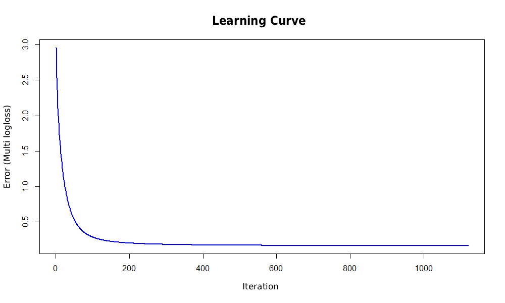

------------------------------------------------------------------------

## Introduction

The aim of this project is to present the process of building, training, and evaluating a multiclass classification model using the **LightGBM** algorithm.

------------------------------------------------------------------------

## Libraries Used

```{r echo=TRUE, message=FALSE, warning=FALSE}
library(caret)
library(tidyverse)
library(lightgbm)
library(MLmetrics)
library(mltools)
library(data.table)
library(pROC)
```

------------------------------------------------------------------------

## Data Loading and Preparation

The data is loaded from the `dane.csv` file. The unnecessary index column `X` is removed.

```{r}
data <- read.csv("dane.csv")
data <- data[, !names(data) %in% "X"]
```

A random seed is set to ensure reproducibility of the results.

```{r}
set.seed(989)
```

------------------------------------------------------------------------

## Data Splitting

The dataset is divided into:

- **80%** – training set,
- **20%** – test set.

```{r}
n <- nrow(data)
nc <- ncol(data)

train_idx <- sample(seq_len(n), size = 0.8 * n)

dane_train <- data[train_idx, ]
dane_test  <- data[-train_idx, ]

dane_train$klasa <- as.factor(dane_train$klasa)
dane_test$klasa  <- as.factor(dane_test$klasa)
```

The target variable `klasa` is converted to a factor.

```{r}
dane_train$klasa <- as.factor(dane_train$klasa)
dane_test$klasa  <- as.factor(dane_test$klasa)
```

------------------------------------------------------------------------

## Data Preparation for LightGBM

The input data is converted into matrices, and class labels are numerically encoded starting from 0.

```{r}
train_x <- as.matrix(dane_train[, !names(dane_train) %in% "klasa"])
train_y <- dane_train$klasa

test_x <- as.matrix(dane_test[, !names(dane_test) %in% "klasa"])
test_y <- dane_test$klasa

train_y <- as.numeric(as.factor(train_y)) - 1
test_y  <- as.numeric(as.factor(test_y)) - 1
```

A `lgb.Dataset` object is created for the training set.

```{r}
dtrain <- lgb.Dataset(data = train_x, label = train_y)
```

------------------------------------------------------------------------

## LightGBM Model Configuration

The model hyperparameters are defined for a multiclass classification task.

**learning_rate = 0.03:** A relatively low value allows the model to learn gradually and steadily.

**feature_fraction = 0.6:** Selects 60% of the features in each iteration, forcing the model to ignore some features and reducing the risk of overfitting.

**max_depth = -1:** No explicit limit on tree depth, as the `num_leaves` and `min_data_in_leaf` parameters provide sufficient control over tree complexity.

**min_data_in_leaf = 25:** Prevents the model from creating rules based on individual or rare observations.

**num_leaves = 50:** A sufficiently high value to capture complex relationships between features while keeping the trees from becoming excessively detailed.

The hyperparameters were selected through iterative model tuning.

```{r}
params <- list(
  objective = "multiclass",
  metric = "multi_logloss",
  num_class = length(unique(train_y)),
  learning_rate = 0.03,
  num_leaves = 50,
  min_data_in_leaf = 25,
  max_depth = -1,
  lambda_l1 = 0.2,
  lambda_l2 = 2,
  feature_fraction = 0.6,
  bagging_fraction = 0.8,
  bagging_freq = 5,
  verbosity = -1
)
```

------------------------------------------------------------------------

## Model Training

The model is trained for 1110 iterations. The number of iterations was determined using cross-validation with a maximum of 2000 rounds and `early_stopping_rounds = 10`. This means that training stops if the evaluation metric does not improve for 10 consecutive iterations.

For a dataset containing 6,238 observations and 26 classes, choosing `nfold = 5` results in approximately 48 observations per class in each validation fold (calculated as: number of observations / (number of folds × number of classes)).

```{r eval=FALSE, message=FALSE, warning=FALSE, include=TRUE}
cv_results <- lgb.cv(
  params = params,
  data = dtrain,
  nrounds = 2000,
  nfold = 5,
  stratified = TRUE,
  early_stopping_rounds = 10,
  verbose = -1,
  eval = "multi_logloss"
)

best_iter <- cv_results$best_iter

model_lgb <- lgb.train(
  params = params,
  data = dtrain,
  nrounds = best_iter,
)
```

The previously trained model is loaded to avoid training it from scratch.

```{r}

model_lgb <- lgb.load("model_lgb.txt")

model_lgb

```

------------------------------------------------------------------------

## Model Prediction and Evaluation

### Accuracy

```{r}
pred_matrix <- predict(model_lgb, test_x)
pred_class <- max.col(pred_matrix) - 1

pred_factor <- factor(pred_class)
true_factor <- factor(test_y)

accuracy <- mean(pred_factor == true_factor)
accuracy
```

Accuracy is calculated for the training set in the same way.

```{r}
pred_matrix_train <- predict(model_lgb, train_x)
pred_class_train <- max.col(pred_matrix_train) - 1
pred_factor_train <- factor(pred_class_train)
true_factor_train <- factor(train_y)
accuracy_train <- mean(pred_class_train == train_y)
accuracy_train
```

------------------------------------------------------------------------

### F-beta Score (beta = 1)

```{r}
beta <- 1
f_beta_score <- FBeta_Score(y_true = true_factor, y_pred = pred_factor, beta = beta)
print(f_beta_score)
```

------------------------------------------------------------------------

### MCC (Matthews Correlation Coefficient)

```{r}
true_dt <- data.table(true = test_y)
pred_dt <- data.table(pred = pred_class)

mcc_score <- mcc(preds = pred_dt$pred, actuals = true_dt$true)
print(mcc_score)
```

------------------------------------------------------------------------

### AUC

AUC is calculated separately for each class, followed by the calculation of the macro-average AUC.

```{r message=FALSE, warning=FALSE}
auc_per_class <- sapply(0:(ncol(pred_matrix)-1), function(cls) {
  roc_response <- ifelse(test_y == cls, 1, 0)
  roc_obj <- roc(roc_response, pred_matrix[, cls + 1])
  auc(roc_obj)
})

auc_macro <- mean(auc_per_class)
print(auc_per_class)
print(auc_macro)
```

------------------------------------------------------------------------

### Learning Curve

```{r eval=FALSE, include=TRUE}
err_val <- unlist(cv_results$record_evals$valid$multi_logloss$eval)

plot(err_val, type = "l", col = "blue",
     xlab = "Round (Iteration)", ylab = "Error (Multi-logloss)",
     main = "Learning Curve - CV", lwd = 2)
```

## 

## Summary

The model achieved an accuracy of 96%, indicating very strong classification performance. The remaining evaluation metrics also indicate that the model performs very well. Based on the results presented above and the learning curve, overfitting does not appear to be a major issue.

We also tested other algorithms, including XGBoost, Random Forest, and AdaBoost. However, none of them achieved comparable results, and training these models took more time.